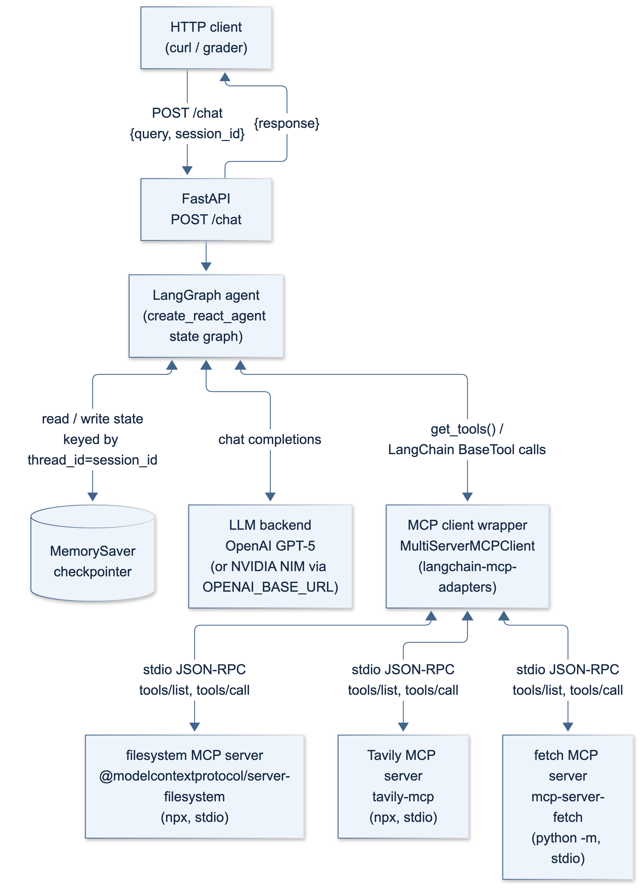

# AgentBridge

### MCP-Powered AI Assistant

[](https://github.com/Sujendra-23/agentbridge-mcp/actions/workflows/scenario-tests.yml)

A conversational AI agent that can search the web, fetch pages, and work with files through the **Model Context Protocol (MCP)**. Built with **LangGraph**, **FastAPI**, and **langchain-mcp-adapters**, with session-based conversation memory and a browser chat interface. Deployed on **Google Cloud Run**.

**[Try the live demo](https://csci599-a1-gtewxoepna-uw.a.run.app/test)** · **[API documentation](https://csci599-a1-gtewxoepna-uw.a.run.app/docs)** · **[Service health](https://csci599-a1-gtewxoepna-uw.a.run.app/health)**

**Engineering evidence:** 28 automated scenario tests cover real MCP tool execution, concurrent conversation isolation, filesystem access boundaries, and recovery from dependency failures. [See the scenarios and results](docs/testing.md).

## Features

- **Tool selection and chaining:** a LangGraph ReAct agent decides when to answer directly and when to call one or more tools.
- **Filesystem operations:** read, write, list, and search files within a configured workspace.
- **Web research:** use Tavily tools for search, extraction, crawling, mapping, and research.
- **URL retrieval:** fetch a specific page through the reference fetch MCP server.
- **Conversation memory:** reuse a session ID to continue a conversation through LangGraph's in-memory checkpointer.
- **Browser chat:** try example prompts, start new sessions, and inspect request timing and JSON payloads.
- **Fault handling:** per-server discovery timeouts, agent invocation timeouts, and JSON error responses.
- **Container deployment:** a multi-stage Docker build includes Python and Node.js for the MCP subprocesses.

## Technology stack

| Component | Technology |
| --- | --- |
| HTTP API | FastAPI, Uvicorn, Pydantic |
| Agent orchestration | LangGraph `create_react_agent` |
| LLM | OpenAI via `langchain-openai`; configurable OpenAI-compatible endpoint |
| Tool integration | `MultiServerMCPClient` from `langchain-mcp-adapters` |
| Conversation state | LangGraph `MemorySaver` |
| Browser client | HTML, CSS, JavaScript |
| Deployment | Docker, Google Cloud Build, Google Cloud Run |

## Architecture



1. The browser or API client sends a query and `session_id` to `POST /chat`.
2. FastAPI invokes the LangGraph agent with `thread_id` set to that session ID.
3. The model answers directly or selects tools exposed by the MCP client.
4. MCP servers execute tool calls over stdio. The agent can use their results to make additional calls.
5. The agent returns a final answer, and the checkpointer retains the conversation in memory.

| MCP server | Package | Purpose |
| --- | --- | --- |
| Filesystem | `@modelcontextprotocol/server-filesystem` | Work with files under `MCP_FILESYSTEM_ROOT` |
| Tavily | `tavily-mcp` | Discover and research information on the web |
| Fetch | `mcp-server-fetch` | Retrieve the content of a known URL |

The filesystem workspace is shared across sessions; conversation history is keyed by session ID.

Additional diagrams: [tool invocation flow](docs/diagrams/tool-invocation-flow.png) · [deployment topology](docs/diagrams/deployment-topology.png). Editable Mermaid sources are included in [docs/diagrams](docs/diagrams).

## Real-world scenario tests

The suite exercises an on-call incident workflow and the failures that can interrupt it. **Latest local validation: 28 passed** on Python 3.13.9, with 15 service tests and 13 MCP integration tests. GitHub Actions runs the suite on pushes and pull requests and retains a JUnit report.

| Scenario | What the tests verify |
| --- | --- |
| Incident research → runbook → saved handoff | A local search MCP server returns a URL; the reference fetch server retrieves it; the official filesystem server writes and reads back the exact fetched content, preserving the source URL and Unicode. |
| Concurrent support conversations | 12 overlapping conversations make 24 HTTP requests; each recalls its own incident code, with four messages in its checkpoint and no other conversation's user messages. |
| Workspace escape attempts | Six real filesystem calls attempt reads and writes through absolute paths, `../` traversal, and symlinks. Every attempt returns a tool error; the outside file remains unchanged and its contents are not returned. |
| Research dependency unavailable | A real MCP subprocess exits or hangs during discovery. Health reports the failure, while a healthy filesystem server still handles a chat-initiated write. |
| Missing handoff file | A real read returns a tool error; the graph receives it and completes a recovery write in the same invocation. |
| Slow or broken agent invocation | A deadline cancels the stalled test invocation, resets request context, and permits the next chat. Provider exceptions and malformed results produce JSON errors without exposing backend exception details. |
| Private URL retrieval | The production fetch arguments retain the server's default loopback protection; a fetch attempt is rejected before contacting the local HTTP fixture. |
| Deployment configuration and state boundaries | Quoted environment values remain intact; tool traces omit argument values; conversations lose memory after state replacement; separate sessions can intentionally share workspace files. |

**Test boundary:** FastAPI, LangGraph, its in-memory checkpointer, MCP stdio transport, and filesystem/fetch subprocesses run for real. Model decisions are scripted locally, and the search server is a controlled fixture. These tests verify orchestration and failure handling; they do not measure live LLM reasoning, Tavily search quality, production throughput, or deployed Cloud Run behavior. No API keys are required, and tests do not load `.env`.

```bash
source .venv/bin/activate
pip install -r requirements-dev.txt

# Full suite: Python 3.13 plus Node.js 24+/npm; initial npx download needs internet.
python -m pytest -q --junitxml=test-results/scenarios.xml

# Fast service checks without MCP subprocesses.
python -m pytest -q -m 'not integration'

# Real MCP integration scenarios only.
python -m pytest -q -m integration
```

The test filesystem server is pinned to `@modelcontextprotocol/server-filesystem@2.0.0`; fetch uses the pinned Python dependency. Temporary workspaces and an ephemeral loopback HTTP fixture keep tests independent of user files and public websites. Production's npm server versions remain unpinned, so dependency upgrades should be validated separately.

The suite exposed and drove fixes for raw exception disclosure in HTTP error responses, configuration substitution that broke on quotes/backslashes/newlines, and incomplete handling of malformed agent results. [Testing notes](docs/testing.md) include reproduction commands, evidence, and design tradeoffs to discuss in a technical walkthrough.

## Quick start

### Prerequisites

- Python 3.13, matching the Docker runtime.
- Node.js and npm, including `npx`, for the filesystem and Tavily MCP servers.
- An OpenAI API key, or a key for a compatible endpoint.
- A Tavily API key for web research tools.

### Install and configure

```bash
git clone https://github.com/Sujendra-23/agentbridge-mcp.git
cd agentbridge-mcp

python3 -m venv .venv
source .venv/bin/activate
pip install -r requirements.txt

cp .env.example .env
```

Edit `.env` and supply your own `OPENAI_API_KEY` and `TAVILY_API_KEY`. The checked-in `.env.example` contains placeholders; the real `.env` is ignored by Git.

| Variable | Purpose | Default / example |
| --- | --- | --- |
| `OPENAI_API_KEY` | API key for the configured model provider | Required for chat |
| `OPENAI_MODEL` | Model identifier | `gpt-5` |
| `OPENAI_BASE_URL` | Optional OpenAI-compatible API endpoint | Unset: OpenAI default |
| `TAVILY_API_KEY` | Tavily credentials | Required for Tavily tools |
| `MCP_FILESYSTEM_ROOT` | Allowed filesystem workspace | `./mcp_workspace` in `.env.example` |
| `MCP_SERVERS_CONFIG` | MCP server manifest | `./mcp_config.json` |
| `MCP_CONNECT_TIMEOUT_SECONDS` | Tool discovery timeout per server | `20` |
| `AGENT_INVOKE_TIMEOUT_SECONDS` | Maximum duration of an agent invocation | `90` |
| `PORT` | Local HTTP port | `8080` |
| `GCP_PROJECT_ID` | Google Cloud project used by `deploy.sh` | Required only for deployment |

To use another OpenAI-compatible provider, set `OPENAI_BASE_URL`, `OPENAI_MODEL`, and that provider's key in `OPENAI_API_KEY`.

### Run

```bash
python main.py
```

Open **http://localhost:8080/test** for chat or **http://localhost:8080/docs** for interactive API documentation. Startup discovers tools from each configured MCP server; the first run may download npm packages.

```bash
curl http://localhost:8080/health
```

The health endpoint reports key presence and tool discovery. It does not validate the model or Tavily credentials by making an inference or search request.

## API usage

| Method | Path | Purpose |
| --- | --- | --- |
| `GET` | `/` | Service status |
| `GET` | `/health` | LLM configuration status and MCP discovery results |
| `GET` | `/test` | Browser chat interface |
| `GET` | `/docs` | Interactive API documentation |
| `POST` | `/chat` | Send a query within a conversation |

### Send a query

```bash
curl -X POST http://localhost:8080/chat \
  -H 'Content-Type: application/json' \
  -d '{"query":"What files are in the workspace?","session_id":"demo-1"}'
```

Request:

```json
{
  "query": "What files are in the workspace?",
  "session_id": "demo-1"
}
```

Successful responses contain a `response` string. For example, a direct arithmetic query could return:

```json
{
  "response": "12 multiplied by 13 is 156."
}
```

Reuse `demo-1` for follow-up questions. Choose a new session ID to start a separate conversation.

### Try the deployed API

```bash
curl -X POST https://csci599-a1-gtewxoepna-uw.a.run.app/chat \
  -H 'Content-Type: application/json' \
  -d '{"query":"What is 12 multiplied by 13?","session_id":"demo-1"}'
```

`/chat` accepts POST requests. Use the [live browser demo](https://csci599-a1-gtewxoepna-uw.a.run.app/test) to chat interactively.

### Example prompts

- “List the files in the workspace.”
- “Create a file called notes.txt containing a short introduction to MCP.”
- “Search for the LangGraph documentation, then fetch the most relevant page.”
- “Search for information about MCP and save a summary to research.txt.”
- “What did I ask in my previous message?” — use the same session ID.

### Error responses

The application returns JSON for handled failures: `400` for blank queries or session IDs, `422` for invalid request schemas, `503` before agent initialization, `504` for invocation timeouts, and `500` for processing failures. Chat error responses omit raw exception details; diagnostics remain in server logs. Tool discovery failures are recorded per server so the agent can initialize with the tools that remain available.

## Run with Docker

```bash
docker build -t agentbridge-mcp .
docker run --rm -p 8080:8080 --env-file .env \
  -e MCP_FILESYSTEM_ROOT=/app/mcp_workspace \
  -e MCP_SERVERS_CONFIG=/app/mcp_config.json \
  agentbridge-mcp
```

The image runs as a non-root user. Credentials are supplied at runtime through the environment.

## Deploy to Google Cloud Run

Install and authenticate the Google Cloud CLI, select a project with billing enabled, and set `GCP_PROJECT_ID` in `.env`.

```bash
gcloud auth login
gcloud config set project YOUR_PROJECT_ID
gcloud services enable run.googleapis.com cloudbuild.googleapis.com

./deploy.sh
```

The script builds and pushes the image using Cloud Build, then deploys service `csci599-a1` to `us-west1`. It enables unauthenticated access and configures 512 MiB of memory, zero minimum instances, and one maximum instance. It prints the service URL after deployment.

Cloud Run, Cloud Build, image storage, model requests, and Tavily usage may incur charges based on the configured accounts and usage.

## Limitations and operational notes

- **Memory is temporary.** Conversation history is held in RAM and is lost when the process restarts or Cloud Run scales to zero. The deployment caps the service at one instance; it does not provide durable session storage.
- **Workspace files are temporary in Cloud Run.** The default container filesystem is ephemeral. Files are shared across sessions and are separate from session memory.
- **Session IDs are not authentication.** The app has no user authentication layer, and clients choose their own session IDs. The deployment script exposes the service publicly.
- **Cold starts can take time.** Container startup includes MCP tool discovery and may include npm downloads if the build-time cache was not populated.
- **Tool discovery is not a credential check.** A connected MCP server may still fail when its external API is called.
- **MCP subprocess environment matters.** The application forwards the parent environment and applies server-specific overrides. The manifest disables npm notifier output to avoid corrupting stdio JSON-RPC messages.

## Project structure

```text
agentbridge-mcp/
├── main.py                         # FastAPI routes, agent, memory, and MCP integration
├── web_test.html                   # Browser chat client
├── mcp_config.json                 # MCP server commands and environment substitution
├── requirements.txt                # Pinned Python dependencies
├── requirements-dev.txt            # Test dependencies
├── pytest.ini                      # Async test configuration and integration marker
├── tests/                          # Service scenarios and real MCP subprocess tests
│   └── fixtures/research_server.py  # Controlled search server and startup fault modes
├── .github/workflows/              # Scenario tests and JUnit artifacts in CI
├── Dockerfile                      # Multi-stage container build
├── deploy.sh                       # Cloud Build and Cloud Run deployment
├── .env.example                    # Configuration template without credentials
├── .gitignore                      # Excludes secrets, caches, and local tooling
├── .dockerignore                   # Excludes local files from the Docker build context
├── mcp_workspace/
│   └── .gitkeep                     # Keeps the initial workspace directory in Git
└── docs/
    ├── testing.md                  # Verified results, test boundaries, design tradeoffs
    └── diagrams/                   # Architecture PNGs and Mermaid sources
```

## MCP server attribution

This project integrates existing MCP servers rather than reimplementing them:

- [Filesystem MCP server](https://github.com/modelcontextprotocol/servers/tree/main/src/filesystem)
- [Tavily MCP server](https://github.com/tavily-ai/tavily-mcp)
- [Fetch MCP server](https://github.com/modelcontextprotocol/servers/tree/main/src/fetch)

Originally developed for CSCI 599, Assignment 1: Tool-Using Agent with MCP Integration.
